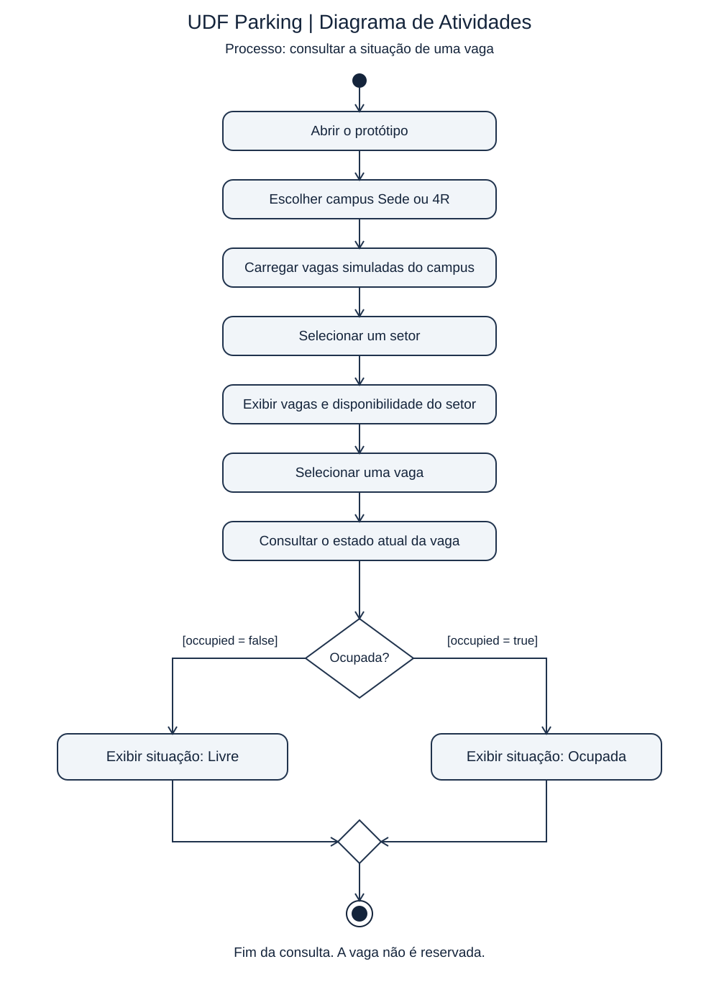
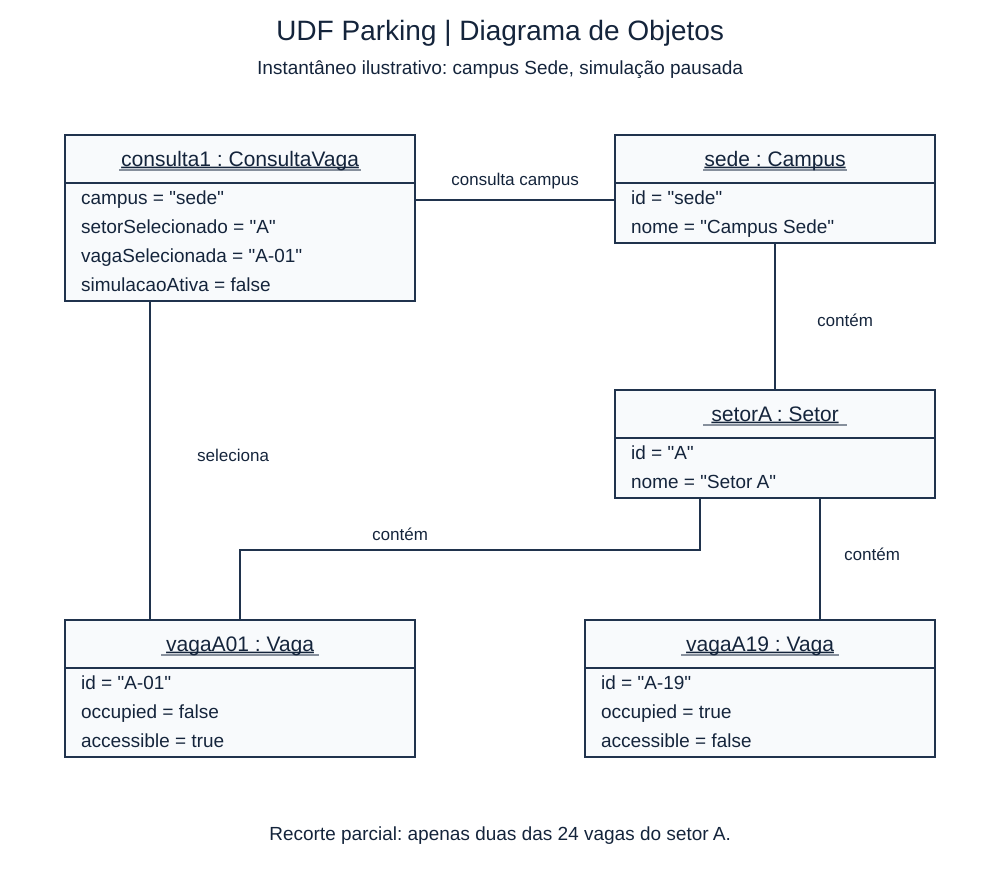

# Modelagem UML do UDF Parking

## Objetivo e escopo

Esta atividade aplica diagramas de atividades e de objetos à consulta de vagas do protótipo UDF Parking. A análise considera o código do protótipo mantido em `pietroviannadeveloper/Analise_Projeto_Sistemas_UDF`, na branch `main` no commit `a94302f53d806430689acca67c7c80c49836d08e`, consultado em 05/11/2026.

O sistema permite alternar entre os campi Sede e 4R, consultar setores e vagas, acompanhar a simulação de veículos, comparar planos e visualizar propostas de benefícios noturnos. Também possui controles de câmera, modo noturno e modo daltônico. O processo escolhido é **consultar a situação de uma vaga**, existente na interface. Reservas, contratação, cobrança e dados reais de ocupação estão fora deste fluxo.

## 1. Diagrama de Atividades

Representa o comportamento de um processo, mostrando ações, sequência de execução e caminhos condicionais.

[Arquivo editável PlantUML](atividades.puml) · [Abrir SVG](atividades.svg)

### Fluxo modelado

1. O estudante abre o protótipo e escolhe o campus. O campus Sede é o padrão, portanto mantê-lo também é uma escolha válida.
2. O sistema carrega o conjunto de vagas simuladas correspondente.
3. O estudante seleciona um setor e o sistema exibe suas vagas e disponibilidade.
4. O estudante seleciona uma vaga pela grade. A maquete também permite selecionar diretamente uma vaga, como atalho fora do caminho detalhado neste diagrama.
5. O sistema consulta o atributo `occupied` e exibe **Livre** ou **Ocupada**.
6. Os caminhos alternativos se unem e a consulta termina. Nenhuma vaga é reservada.

A propriedade `accessible` é uma informação complementar exibida nos detalhes. Uma vaga acessível pode estar livre ou ocupada, portanto não é uma terceira alternativa à decisão de ocupação. Atualizações automáticas da simulação são um processo independente, não detalhado aqui. O fim do diagrama encerra esta consulta, não o aplicativo.

### Elementos e notação

| Elemento | Representação | Uso no diagrama |
| --- | --- | --- |
| Nó inicial | Círculo preenchido | Início da consulta |
| Ação | Retângulo com cantos arredondados | Abrir, selecionar, carregar e exibir |
| Fluxo de controle | Linha com seta | Ordem de execução |
| Decisão | Losango com uma entrada e duas saídas | Verificar `occupied` |
| Guarda | Condição entre colchetes | `[occupied = true]` e `[occupied = false]` |
| Mesclagem | Losango com duas entradas e uma saída | Reunir caminhos alternativos |
| Nó final de atividade | Círculo preenchido dentro de outro círculo | Encerrar a consulta |

As guardas são mutuamente exclusivas e cobrem os dois valores booleanos. Não há barras de fork/join porque este fluxo não modela ações paralelas. O losango após as alternativas é uma mesclagem, não uma sincronização.

## 2. Diagrama de Objetos

Representa instâncias concretas e seus valores em um instante específico, com links entre essas instâncias. Diferentemente de um diagrama de classes, mostra um exemplo de estado, não uma definição geral de todos os tipos do sistema.

[Arquivo editável PlantUML](objetos.puml) · [Abrir SVG](objetos.svg)

### Cenário representado

O estudante está no campus Sede, com a simulação pausada, o setor A selecionado e os detalhes da vaga A-01 abertos. No instantâneo, A-01 está livre e é acessível. A-19 está ocupada e não é acessível. Esses valores de ocupação e acessibilidade correspondem ao conjunto inicial definido por `sedeSpaces()` antes das movimentações. Trata-se de um cenário ilustrativo possível, não de dados reais coletados.

O desenho é um recorte parcial: o setor A possui 24 vagas no protótipo, mas apenas duas aparecem. Os setores B e V e as demais vagas foram omitidos para facilitar a leitura. A comparação entre A-01 e A-19 evidencia valores diferentes do mesmo tipo de objeto.

### Objetos, atributos e relacionamentos

| Instância | Tipo conceitual | Papel |
| --- | --- | --- |
| `consulta1` | `ConsultaVaga` | Estado da consulta na interface |
| `sede` | `Campus` | Campus selecionado |
| `setorA` | `Setor` | Agrupamento das vagas consultadas |
| `vagaA01` | `Vaga` | Vaga selecionada, livre e acessível |
| `vagaA19` | `Vaga` | Outra vaga do mesmo setor, ocupada |

Os cabeçalhos usam `nomeDaInstancia : Tipo` sublinhado. Os compartimentos mostram slots na forma `atributo = valor`. Textos aparecem entre aspas e booleanos usam `true`/`false`. As linhas contínuas sem setas são **links entre instâncias**, rotulados com o significado da associação. Não representam herança nem sequência de ações. Não foram adicionadas multiplicidades de classes a esse instantâneo.

### Correspondência com a implementação

Esta é uma modelagem conceitual do estado do protótipo, não uma alegação de que existem classes TypeScript com esses nomes ou um banco de dados implementado.

| Modelo | Correspondência no código |
| --- | --- |
| `Campus` | `CampusId`, valores `sede` e `4r`, e estado React `campus` |
| `Setor` | Itens de `sectors` em `app/page.tsx` e campo `sector` de cada vaga |
| `Vaga` | Tipo TypeScript `Space` em `app/scene.tsx` |
| `id`, `occupied`, `accessible` | Campos efetivos de `Space` |
| `ConsultaVaga` | Agrupamento conceitual dos estados React da interface |
| `setorSelecionado` | Estado `selected` |
| `vagaSelecionada` | Estado `space` |
| `simulacaoAtiva` | Estado `playing` |
| Links entre objetos | Relações por identificadores, seleção e agrupamento, não necessariamente referências diretas em memória |

Os atributos gráficos `x`, `z`, `rotation` e `lane` não aparecem porque não são necessários para explicar a consulta de disponibilidade.

## 3. Revisão dos diagramas

- [x] Processo e cenário correspondem a funcionalidades presentes no protótipo.
- [x] Atividades têm início, sequência, decisão, guardas, mesclagem e fim.
- [x] A decisão cobre os dois estados possíveis de ocupação.
- [x] Objetos têm identidade, tipo, atributos e valores concretos.
- [x] Cabeçalhos das instâncias estão sublinhados no SVG.
- [x] Links conectam objetos existentes e possuem significado explícito.
- [x] Acessibilidade e ocupação são propriedades independentes.
- [x] O recorte parcial e a natureza conceitual da modelagem estão documentados.
- [x] O fluxo não cria reservas nem apresenta simulação como dado real.

## 4. Arquivos e manutenção

Os SVGs permitem visualizar os diagramas diretamente neste README. Os arquivos `.puml` contêm a versão textual editável em PlantUML. Ambos representam os mesmos elementos e relações, com disposição gráfica independente. Ao modificar a modelagem, mantenha as duas versões sincronizadas. A renderização PlantUML pode variar conforme a versão da ferramenta.

## Referências

- OBJECT MANAGEMENT GROUP. **OMG Unified Modeling Language, versão 2.5.1**. 2017. [Especificação oficial](https://www.omg.org/spec/UML/2.5.1). Acesso em: 5 nov. 2026. Seções sobre InstanceSpecification e Activities.
- [Código analisado: app/page.tsx](https://github.com/pietroviannadeveloper/Analise_Projeto_Sistemas_UDF/blob/a94302f53d806430689acca67c7c80c49836d08e/app/page.tsx).
- [Código analisado: app/scene.tsx](https://github.com/pietroviannadeveloper/Analise_Projeto_Sistemas_UDF/blob/a94302f53d806430689acca67c7c80c49836d08e/app/scene.tsx).
